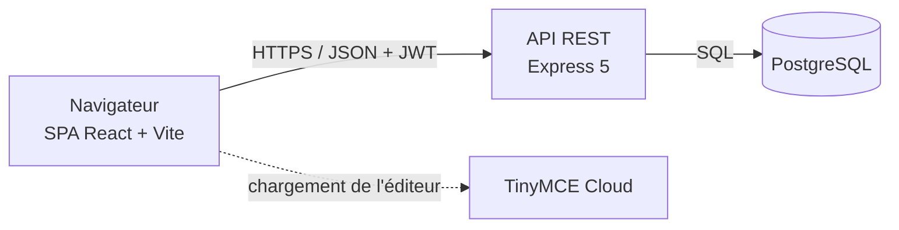
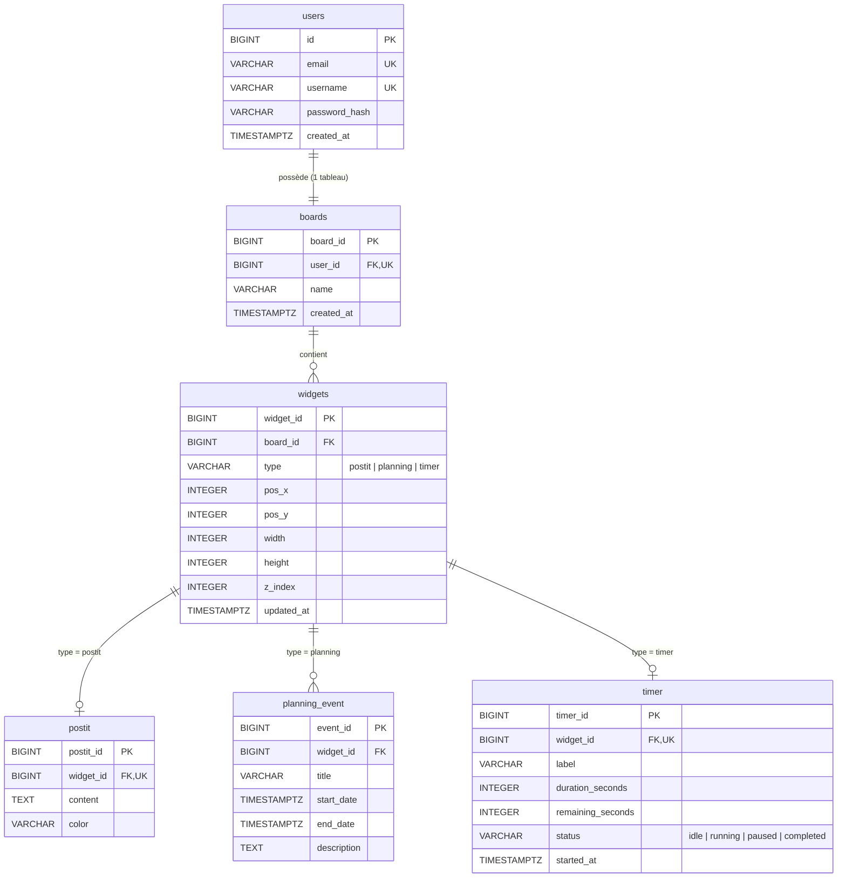

# MonEspace

> Un tableau de bord personnel modulaire pour s'organiser au quotidien.

MonEspace est une application web qui permet de créer un compte puis d'accéder à un tableau blanc sur lequel on dispose librement des « widgets » : des petits modules qui centralisent ses notes, son planning et sa gestion du temps sur un seul écran. Chaque utilisateur a son propre tableau, retrouvé à l'identique à chaque connexion.

Projet de fin de spécialisation — Holberton School (MVP, version 1.0).

## Sommaire

- [Fonctionnalités](#fonctionnalités)
- [Technologies](#technologies)
- [Architecture](#architecture)
- [Schéma de la base de données](#schéma-de-la-base-de-données)
- [API](#api)
- [Structure du projet](#structure-du-projet)
- [Installation](#installation)
- [Variables d'environnement](#variables-denvironnement)
- [Déploiement](#déploiement)
- [Évolutions envisagées](#évolutions-envisagées)

## Fonctionnalités

- **Compte utilisateur** : inscription, connexion par email ou pseudo, session par token JWT.
- **Tableau de bord personnel** : un tableau par utilisateur, créé automatiquement à la première visite.
- **Trois widgets** :
  - **Post-it** : note à mise en forme riche (gras, italique, listes, polices, tailles) grâce à TinyMCE.
  - **Planning** : liste d'événements datés, avec ajout, modification et suppression.
  - **Timer** : minuteur configurable (type Pomodoro) avec démarrer, pause et réinitialisation. Il reste exact après un rechargement de la page.
- **Glisser-déposer et redimensionnement** : position et taille de chaque widget sont sauvegardées.
- **Page Calendrier** : vue mensuelle regroupant les événements de tous les plannings.
- **Lanceur de widgets** : menu d'icônes pour ajouter un Post-it, un planning ou un timer.
- **Thème clair / sombre**, mémorisé d'une visite à l'autre.

## Technologies

| Couche | Technologies |
|---|---|
| Frontend | React 19, Vite, React Router, dnd-kit, FullCalendar, TinyMCE Cloud |
| Backend | Node.js, Express 5, bcrypt, jsonwebtoken |
| Base de données | PostgreSQL (driver `pg`) |
| Tests | `node:test` (API), Playwright (end-to-end) |
| Déploiement | Netlify (frontend), Render (API et base de données) |

## Architecture



Le modèle de données repose sur une table `widgets` générique (type, position, taille, ordre d'empilement) et une table par type de widget : `postit`, `planning_event` et `timer`. Ajouter un nouveau type de widget revient à ajouter une table et un composant, sans toucher au système de positionnement.

Le timer ne fait pas tourner de compteur côté serveur : il stocke l'heure de démarrage et le temps restant, puis recalcule son état à chaque lecture.

## Schéma de la base de données



| Table | Rôle |
|---|---|
| `users` | Comptes utilisateurs (email et pseudo uniques, mot de passe haché avec bcrypt) |
| `boards` | Un tableau par utilisateur |
| `widgets` | Widget générique placé sur un tableau |
| `postit` | Contenu et couleur d'un Post-it |
| `planning_event` | Événements d'un planning (plusieurs par widget) |
| `timer` | Durée, temps restant, état et heure de démarrage |

Toutes les clés étrangères sont en `ON DELETE CASCADE` : supprimer un utilisateur supprime son tableau, ses widgets et leur contenu. Un trigger met à jour `widgets.updated_at` à chaque modification.

Les migrations se trouvent dans `MonEspace/backend/src/db/migrations/` (`001` à `004`).

## API

| Méthode | Endpoint | Description |
|---|---|---|
| POST | `/api/auth/register` | Création de compte |
| POST | `/api/auth/login` | Connexion, renvoie un JWT |
| GET | `/api/auth/me` | Utilisateur connecté |
| GET | `/api/boards` | Tableau de l'utilisateur et ses widgets |
| POST | `/api/widgets` | Création d'un widget |
| PATCH | `/api/widgets/:id` | Position, taille ou contenu d'un Post-it |
| DELETE | `/api/widgets/:id` | Suppression d'un widget |
| GET, POST | `/api/widgets/:widgetId/events` | Liste et ajout d'événements |
| PATCH, DELETE | `/api/widgets/:widgetId/events/:eventId` | Modification et suppression d'un événement |
| GET | `/api/widgets/:widgetId/timer` | État du timer |
| PATCH | `/api/widgets/:widgetId/timer/duration` | Changement de durée |
| POST | `/api/widgets/:widgetId/timer/start`, `pause`, `reset` | Contrôle du timer |

Toutes les routes, hors inscription et connexion, exigent un token JWT valide dans l'en-tête `Authorization: Bearer <token>`.

## Structure du projet

```text
MonEspace/
├── backend/
│   ├── src/
│   │   ├── db/            connexion PostgreSQL et migrations SQL
│   │   ├── middleware/    vérification du JWT
│   │   ├── models/        accès aux données (widgets, événements, timer)
│   │   ├── routes/        endpoints REST
│   │   └── server.js
│   └── test/              tests de l'API
├── frontend/
│   ├── src/
│   │   ├── components/    WidgetContainer, PostItWidget, PlanningWidget, TimerWidget
│   │   └── pages/         Login, Register, DashboardPage, CalendarPage
│   └── e2e/               tests Playwright
netlify.toml               configuration du frontend
render.yaml                configuration de l'API et de la base
```

## Installation

Prérequis : Node.js 22+, PostgreSQL 14+ avec `psql`.

**1. Base de données** : crée une base vide, puis applique les migrations dans l'ordre.

```bash
createdb monespace
cd MonEspace/backend
psql $DATABASE_URL -v ON_ERROR_STOP=1 -f src/db/migrations/001_create_users.sql
psql $DATABASE_URL -v ON_ERROR_STOP=1 -f src/db/migrations/002_create_boards.sql
psql $DATABASE_URL -v ON_ERROR_STOP=1 -f src/db/migrations/003_create_widgets.sql
psql $DATABASE_URL -v ON_ERROR_STOP=1 -f src/db/migrations/004_add_timer_remaining_seconds.sql
```

**2. Variables d'environnement** : voir la section ci-dessous.

**3. Lancement** : dans deux terminaux.

```bash
# API (http://localhost:5000)
cd MonEspace/backend && npm ci && npm run dev

# Frontend (http://localhost:5173)
cd MonEspace && npm ci && npm run dev
```

**Tests** : `npm test` dans `MonEspace/backend` pour l'API, `npm run test:e2e` dans `MonEspace` pour Playwright.

## Variables d'environnement

| Fichier | Variable | Description |
|---|---|---|
| `MonEspace/backend/.env` | `DATABASE_URL` | URL de connexion PostgreSQL |
| | `JWT_SECRET` | Secret de signature des tokens |
| | `FRONTEND_URL` | URL du frontend autorisée par CORS |
| | `PORT` | Port de l'API (5000 par défaut) |
| `MonEspace/.env.local` | `VITE_API_URL` | URL de l'API (ex. `http://localhost:5000`) |
| | `VITE_TINYMCE_API_KEY` | Clé TinyMCE Cloud |

> **TinyMCE** : la clé doit être créée sur [tiny.cloud](https://www.tiny.cloud/) et le domaine utilisé (`localhost`, l'URL Netlify) doit être ajouté dans *Approved Domains*. Sans clé ou avec un domaine non approuvé, le Post-it bascule automatiquement sur un champ texte simple. Le serveur Vite doit être redémarré après toute modification du `.env.local`.

## Déploiement

Le frontend est déployé sur **Netlify** (`netlify.toml`) et l'API avec sa base PostgreSQL sur **Render** (`render.yaml`).

1. Render : créer le Blueprint depuis le dépôt (API + base PostgreSQL).
2. Exécuter une seule fois les migrations `001` à `004` sur la base Render.
3. Netlify : importer le dépôt et définir `VITE_API_URL` et `VITE_TINYMCE_API_KEY`.
4. Render : renseigner `FRONTEND_URL` avec l'URL Netlify, puis redéployer l'API.
5. TinyMCE : ajouter l'URL Netlify aux domaines approuvés.

## Évolutions envisagées

- Nouveaux widgets (liste de tâches Kanban, météo, notes vocales, citation du jour).
- Partage d'un tableau entre plusieurs membres d'une même organisation.
- Notifications pour les échéances du planning et la fin d'un timer.
- Synchronisation avec des agendas externes (Google Calendar, Outlook).
